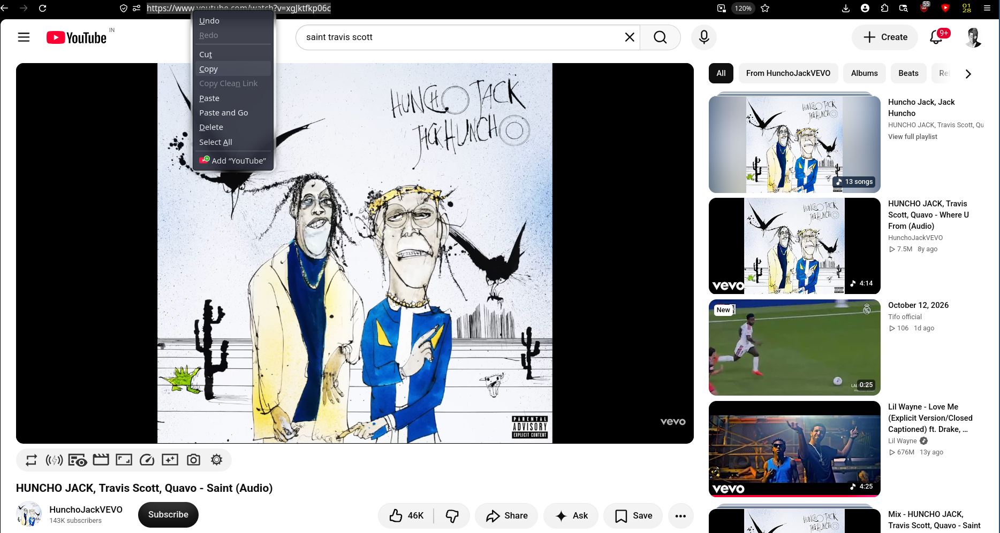
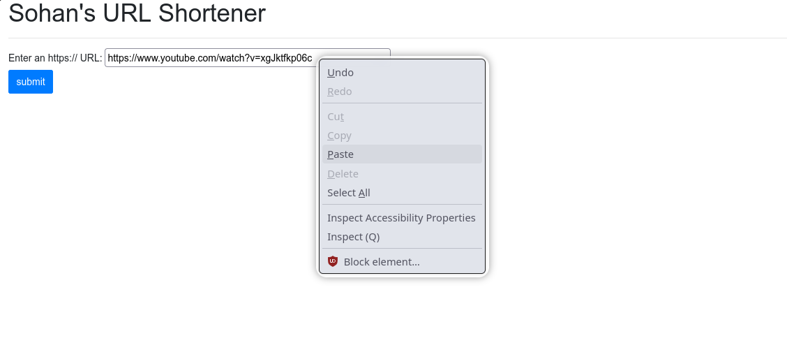
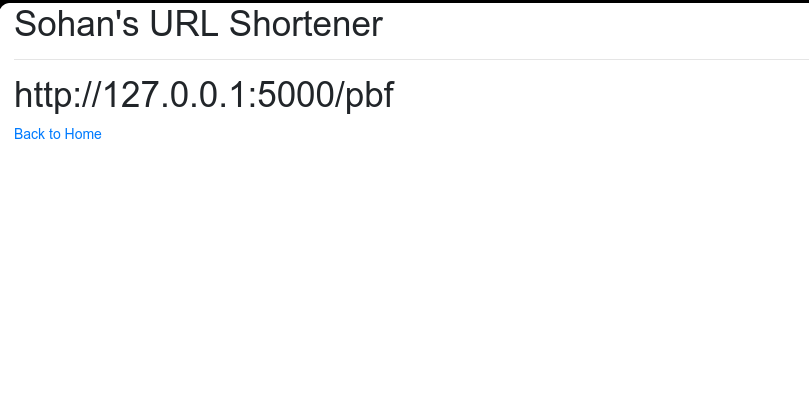

# URL Shortener Lab

Same old project, but this time I'll be experimenting with it just to explore the backend world.

As they say,

*This site keeps changing, because a new world needs new experiments.*
## How It Works

1. `GET /` renders the home page.
2. `POST /` receives the URL submitted by the user.
3. The application checks SQLite to see if the URL already exists.
4. If it exists, the existing short code is reused.
5. Otherwise, a three-character code is generated and the URL mapping is stored in the database.
6. `GET /display/<url>` displays the generated short code.
7. `GET /<short>` looks up the short code and redirects the user to the original URL.
## Screenshots

### 1. Original URL
The original URL before shortening.

### 2. Entering the Original URL
Pasting the original URL into the URL Shortener web application.

### 3. Generated Short URL
The application displays the generated short code.

### 4. URL Redirection
Opening the short URL redirects the browser to the original destination.

